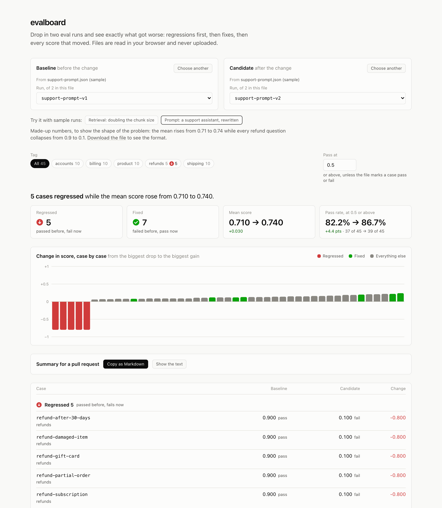
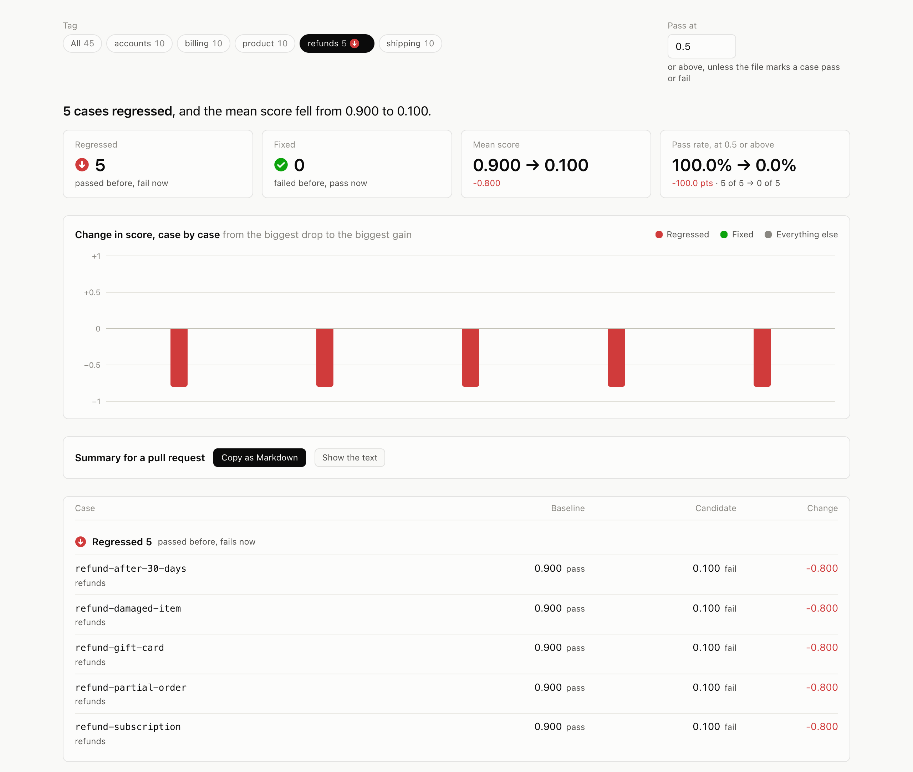
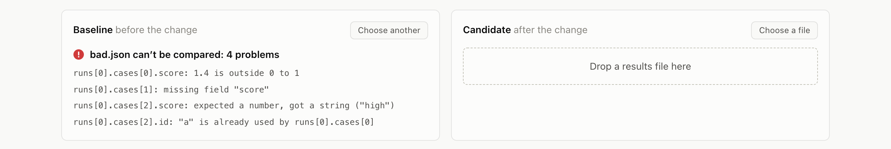

# evalboard

**Drop in two eval runs. See exactly what got worse.**

[](https://github.com/mohsinaliwork686-rgb/evalboard/actions/workflows/ci.yml)
[](LICENSE)

**Try it:** https://mohsinaliwork686-rgb.github.io/evalboard/



---

## The problem

You change a prompt and the eval's average goes from 0.71 to 0.74. Ship it? Underneath, forty cases
improved a little and five collapsed from 0.9 to 0.1, and they were all the same customer scenario.
The average hid it completely.

An eval is a fixed set of test cases an AI system is run against, each one scored, usually between
0 and 1. It is how you know whether a change helped. Most tools report it as one number, and one
number is exactly what hides a regression.

## What it does

A web page. Load two results files and it shows, case by case:

- **Regressions first**: cases that passed before and fail now
- **Fixes**: cases that failed before and pass now
- **Every score change**, sorted by how far it moved, with a chart that makes a cluster of
  collapses stand out
- **A tag filter**, to look at one category at a time. Each tag shows how many of its cases regressed
- **A Markdown summary** to paste into a pull request

The average is still shown, but never on its own: the headline always leads with the regression
count.

Files are read in the browser and never uploaded. There is no backend.

## What the samples show

The page has two built-in samples, so you can try it without a file of your own.

**A support prompt, rewritten** (made-up numbers). The mean score rises from 0.710 to 0.740 and the
pass rate from 82.2% to 86.7%. Both look like a win. But five cases regressed, and the tag filter
shows they are all refund questions: every one fell from 0.9 to 0.1.



**Retrieval, doubling the chunk size** (real runs from
[ragsweep](https://github.com/mohsinaliwork686-rgb/ragsweep)'s example). Chunks of 512 against 1024
characters over a 17-document handbook. The mean rises from 0.828 to 0.892, and the pass rate stays
at exactly 90.3%. So by both numbers nothing broke. Case by case, two questions now fail and two
others now pass, and they cancel out. The two that broke are both worded differently from the
handbook, a known weak spot of keyword search.

## The results file

evalboard reads the file [ragsweep](https://github.com/mohsinaliwork686-rgb/ragsweep) writes, so
the two work as a pair: sweep retrieval settings with one, compare any two runs with the other. The
format is small on purpose, so any eval tool can write it:

```json
{
  "schema": 1,
  "tool": "my-evals",
  "corpus": { "fingerprint": "d53c7ae1a1b0976c" },
  "runs": [
    {
      "id": "prompt-v2",
      "cases": [
        { "id": "refund-window", "score": 1.0, "tags": ["refunds"] },
        { "id": "manager-signoff", "score": 0.0, "tags": ["approvals"], "passed": false }
      ]
    }
  ]
}
```

| Field | Rule |
|-------|------|
| `schema` | Required, must be `1`. A file from a newer version is refused with a message saying so |
| `runs` | Required, at least one. Each run needs an `id`, unique in the file |
| `runs[].cases` | Required, at least one. Each case needs an `id`, unique in the run, and a `score` from 0 to 1 |
| `tags` | Optional list of strings, for the tag filter |
| `passed` | Optional. When present it decides pass or fail, whatever the score |
| `corpus.fingerprint` | Optional. Identifies the documents the run was made over (see below) |
| `tool` | Optional. The name of whatever wrote the file |
| anything else | Ignored, so extra fields (ragsweep's `config`, `metrics`, `expected`...) do no harm |

A file can hold many runs. ragsweep writes one per combination of settings, so comparing two
settings means picking two runs from the same file. Each sample can be downloaded from the page,
which is the quickest way to see a complete file.

**A bad file gets every problem listed, each with where it is**, instead of "failed to parse":



## How two runs are compared

- **Cases are matched by `id`, never by position.** Adding a case in the middle of a set does not
  shift every comparison after it.
- **Pass or fail** comes from the case's `passed` if it has one; otherwise the score is compared
  with the pass mark, 0.5 by default and adjustable on the page. The summary always prints it,
  because a pass rate without its pass mark means nothing.
- **Every case falls into exactly one group:**

  | Group | Meaning |
  |-------|---------|
  | Regressed | passed in the baseline, fails in the candidate |
  | Fixed | failed in the baseline, passes in the candidate |
  | Worse / better | same pass or fail, but the score moved |
  | Unchanged | same score |
  | Removed / added | in only one of the two runs |

For a ragsweep file the score is the reciprocal rank of the right passage: 1 if it came first, 0.5
if second, and 0 if it was not found. A pass mark of 0.5 therefore means "the right passage came
first or second".

Colour is never the only signal. Every group also has a word and an icon, and every bar in the
chart is also a row in the table below it.

## Runs over different documents

If both files carry a corpus fingerprint and the fingerprints differ, the runs were made over
different documents, and comparing them case by case is usually a mistake. evalboard says so and
shows nothing until you choose **Compare anyway**.

## Nothing leaves the page

The site is a set of static files on GitHub Pages. A loaded file is read in your browser and goes
nowhere else. A browser test checks this directly: it loads a file containing a marker string,
compares, filters and copies the summary, and fails if any request in that time is not a GET, has
a body, goes to another site, or carries the marker.

## Run it

```bash
npm install
npm run dev          # http://localhost:3000
```

```bash
npm test             # unit tests for the logic
npm run check        # type check, lint, unit tests and the static build
npm run e2e          # browser tests against the build, at desktop and phone sizes
```

## How it is built

All the logic lives in `src/lib/` as plain TypeScript, with no React in it. The components only
display what it returns, so the logic is tested thoroughly without a browser, and the browser tests
only have to prove the page is wired up.

| Module | Job |
|--------|-----|
| `schema.ts` | The format, and a validator that returns every problem with its path |
| `diff.ts` | Two runs and a pass mark in; grouped cases and the headline numbers out |
| `summary.ts` | A comparison in, Markdown out |
| `chart.ts` | Sorts the changes and picks the chart's scale |
| `corpus.ts` | The different-documents check |
| `load.ts` | Reads a dropped file, with a 50 MB limit |
| `samples.ts` | The built-in samples, checked by the same validator as any other file |

The tests also validate a real ragsweep results file, so if the two repositories' formats ever drift
apart, the tests fail. The design decisions, and why they were made, are in
[`docs/IMPLEMENTATION_PLAN.md`](docs/IMPLEMENTATION_PLAN.md).

## Non-goals

- **It does not run evals.** It reads their results.
- **It stores nothing.** No accounts, no history, no uploads.
- **No statistics beyond the per-case view.** No significance tests in this version. The per-case
  view is what the average hides, and it is the point.

## License

MIT. See [LICENSE](LICENSE).
